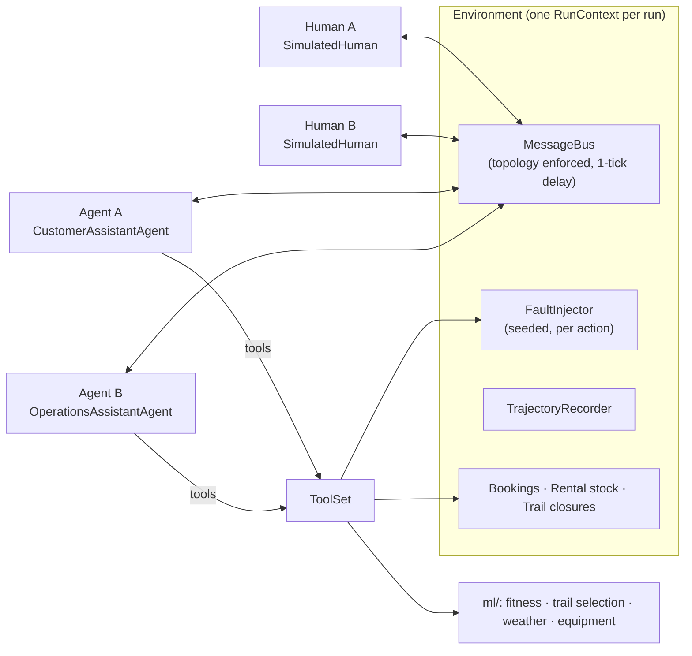

# Picos de Europa trip planner: a two-agent LangGraph simulation

This is a small multi-agent system that plans a guided one-day hike in Picos de Europa. It has two agents and two simulated humans, connected only like this:

```
Human A (customer) ⇄ Agent A (customer assistant) ⇄ Agent B (operations assistant) ⇄ Human B (mountain guide)
```

- **Agent A** picks a trail that fits the customer's health and interests, finds the days with the best weather and checks the gear.
- **Agent B** runs the company side: trail closures, guide availability, the booking and gear rental. Human B must approve every trip.

Stack: **LangGraph** (agents), **OpenAI** (LLM), **Open-Meteo** (live weather), **Langfuse** (tracing), **FastAPI** and a **CLI** (entrypoints), a **React** frontend over **AG-UI**. Python 3.12, managed with `uv`.

---

## Quick start

```powershell
uv sync                                   # install
copy .env.example .env                    # then set TRIP_OPENAI_API_KEY
uv run pytest                             # 29 tests, no API key needed
uv run python -m trip_planner.app.simulation_launcher --runs 5
```

The CLI prints one line per run and then the batch summary. Each run is written to `trajectories/<batch_id>/run_<i>.json`, and the summary to `summary.json` in the same folder.

| Flag | Meaning |
|---|---|
| `--runs N` | runs in a row (default 5) |
| `--weather fixture` | use the recorded forecast in `trip_planner/data/weather_fixture.json` instead of the live one (offline, fully reproducible) |
| `--scenario NAME` | scenario file `trip_planner/data/scenarios/NAME.yaml` |
| `-v` | debug logs |

### HTTP API

```powershell
uv run uvicorn trip_planner.app.service_launcher:app
```

- `GET /health/live`, `GET /health/ready`
- `POST /simulations` with body `{"runs": 1, "scenario": null}`. Returns the summary and every trajectory. The call is synchronous: a run takes about 30–60 s.
- `GET /simulations/{batch_id}` returns a stored batch.
- `POST /agui` streams a live run over AG-UI (see [Frontend](#frontend-ag-ui)).
- Docker: `docker build -f trip_planner/Dockerfile -t trip-planner .`, then `docker run -p 8000:8000 --env-file .env trip-planner`.

### Frontend (AG-UI)

[`frontend/`](frontend) is a React app that talks to the API over the [AG-UI protocol](https://docs.ag-ui.com) (`@ag-ui/client` → `POST /agui`, server-sent events). It has two modes:

- **Watch a simulation:** plays one full run with both simulated humans and streams it live: every message between the four participants, every tool call with its arguments and result, injected faults and retries, the tick, live token counts and the final plan.
- **Play the customer:** you are Human A. Agent A, Agent B and the simulated guide run as usual. The simulation pauses whenever Agent A's reply reaches you, and goes on when you answer. Once a plan is delivered, **Accept plan & finish** ends the run as `converged`.

```powershell
uv run uvicorn trip_planner.app.service_launcher:app   # API on :8000
cd frontend; npm install; npm run dev                  # UI on http://localhost:5173
```

The Vite dev server proxies `/agui` and `/health` to `TRIP_API_URL` (default `http://localhost:8000`). With `docker compose up -d` the UI is served by nginx on http://localhost:8080 (`FRONTEND_PORT`). Live runs are saved to `trajectories/live/<run_id>.json`.

How the simulation maps onto AG-UI events ([`inference/services/agui.py`](trip_planner/app/inference/services/agui.py)):

| Simulation | AG-UI |
|---|---|
| tick | `STEP_STARTED` / `STEP_FINISHED` (`tick N`) |
| message | `TEXT_MESSAGE_START/CONTENT/END`; `name` is the sender, `metadata.recipient` the recipient |
| tool call and result | `TOOL_CALL_START/ARGS/END`, `TOOL_CALL_RESULT`; `metadata.participant` is the agent (`send_message` is shown as the message itself) |
| tick, status, live metrics, final plan, incidents | shared state: `STATE_SNAPSHOT`, then JSON Patch `STATE_DELTA` |
| waiting for you (play mode) | `RUN_FINISHED` with `result.status = "awaiting_input"` |

`forwardedProps` sets `mode` (`watch` | `play`), `scenario` and, in play mode, `conversationComplete`. A play run lives in memory per `threadId`; it gives up after `TRIP_SIMULATION_LIVE_INPUT_TIMEOUT_S` (30 min) without a reply, and at most `TRIP_SIMULATION_MAX_LIVE_RUNS` (20) live runs exist at once. A watch run is cancelled when the browser disconnects.

### Langfuse (optional)

The root [`docker-compose.yml`](docker-compose.yml) runs the API together with a self-hosted Langfuse v3 (web, worker, Postgres, ClickHouse, Redis, MinIO):

```powershell
docker compose up -d                  # API on :8000, UI on :8080, Langfuse on :3000
docker compose up -d langfuse-web     # Langfuse only; run the app with uv
```

On first start Langfuse creates a project with fixed API keys (`pk-lf-local-dev` / `sk-lf-local-dev`) and an admin user (`admin@example.com` / `admin12345`), and the `trip-planner` container is already pointed at it. To trace runs started with `uv` against this Langfuse, put those keys in `.env` with `TRIP_OBSERVABILITY_LANGFUSE_HOST=http://localhost:3000`. These defaults are for local use only; override them (`LANGFUSE_INIT_*`, `LANGFUSE_ENCRYPTION_KEY`, `LANGFUSE_SALT`, `LANGFUSE_NEXTAUTH_SECRET`, database passwords) in `.env` before exposing the stack. If a port is taken, change it with `LANGFUSE_PORT` (3000), `MINIO_PORT` (9090) or `TRIP_PLANNER_PORT` (8000). `docker compose down -v` wipes the Langfuse data.

You can also use Langfuse Cloud: set `TRIP_OBSERVABILITY_LANGFUSE_PUBLIC_KEY`, `..._SECRET_KEY` and `..._HOST`.

In Langfuse:
- every run is one **session** (`<batch_id>-run<i>`);
- every agent turn and human reply is a trace, tagged with the batch id and the participant.

Without keys, tracing is off. The same metrics are still computed locally (see [Metrics](#observability-and-metrics)).

---

## How it works



### Discrete-time environment (`ml/environment/`)

[`Simulation`](trip_planner/app/ml/environment/core.py) runs one scenario as a sequence of ticks.

- **Tick 0: the input that starts the run.** The two initiators (Human A and Human B) act on an empty inbox and send their opening messages.
- **Every later tick:** the `MessageBus` delivers what was sent in the previous tick. Every participant with mail then acts **concurrently** (`asyncio.gather`), and anything they send is delivered at the next tick.
- **The run ends** in one of three ways:
  - `converged`: the customer marks the conversation complete after receiving the final plan;
  - `stalled`: no message is in flight;
  - `timeout`: `max_ticks` is reached.
- **Topology:** [`MessageBus`](trip_planner/app/ml/environment/message_bus.py) enforces fig. 1. A message to anyone outside your neighbours is rejected and recorded.
- **Per-run state:** everything that belongs to one run (bus, recorder, fault injector, bookings, rental stock, closures) lives in a [`RunContext`](trip_planner/app/ml/environment/run_context.py). The agents and tools are built once and reach the active run through a `ContextVar`, so runs never share state.

### Generic agent (`agents/base.py`)

[`BaseAgent`](trip_planner/app/agents/base.py) is the single agent architecture.
- It is a LangGraph `StateGraph`: `model → tools → observe → model …`, ending when the model stops calling tools.
- One call to `act()` is one turn on the messages of one tick.
- Sending a message is a tool too (`send_message`), so communication and actions go through the same loop.

An agent is **set up only by its tools and its instructions**:

| | Agent A: `CustomerAssistantAgent` | Agent B: `OperationsAssistantAgent` |
|---|---|---|
| Tools | `assess_fitness`, `search_trails`, `get_weather_forecast`, `check_equipment`, `send_message`, `deliver_final_plan` | `get_trail_status`, `check_guide_availability`, `create_booking`, `check_rental_stock`, `reserve_rental_gear`, `send_message` |
| Instructions | [`customer_assistant/prompts.py`](trip_planner/app/agents/customer_assistant/prompts.py) | [`operations_assistant/prompts.py`](trip_planner/app/agents/operations_assistant/prompts.py) |

How the agents are kept separate and how tools are exposed:
- **Separate state:** each agent has its own checkpointer, with one thread per run.
- **Fresh system prompt:** it is rebuilt on every call with today's date and the agent's allowed recipients, and is never stored in the state.
- **Tools from methods:** tools are plain async methods with Google docstrings. They become LangChain tools through `StructuredTool.from_function(parse_docstring=True)`.
- **Injected sender:** the sender id is injected with `InjectedState`, so the LLM cannot fake it.

### Simulated humans (`ml/simulated_human/`)

Each human has a fixed persona from the scenario YAML. It opens with a scripted message, then answers through an LLM at temperature 0 with structured output (`HumanTurn{message, conversation_complete}`). So the end of the conversation is an explicit signal, not something parsed out of free text.

### Scenario and expected trajectory

Source: [`data/scenarios/default.yaml`](trip_planner/data/scenarios/default.yaml).

- **Human A** is 45, moderately fit, has a mild knee injury, wants lake or gorge views, owns boots, a rain jacket and a backpack.
- **Human B** does not work Mondays or Tuesdays, says Ruta del Cares is closed, and wants helmets on routes with rockfall risk.

| tick | event |
|---|---|
| 0 | Human A → Agent A: trip request. **In parallel**, Human B → Agent B: closures and days off |
| 1 | Agent A: `assess_fitness` → `search_trails` → `get_weather_forecast`, then sends the booking request to Agent B (top-3 trails, top-3 dates). Agent B records Human B's notice silently |
| 2 | Agent B: `get_trail_status` (Cares closed) and `check_guide_availability`, picks the first feasible option and asks Human B for approval |
| 3 | Human B approves: "helmet required, meet 08:00" |
| 4 | Agent B: `create_booking`, then sends the confirmation to Agent A |
| 5 | Agent A: `check_equipment`, then sends a rental request (helmet, poles, …) to Agent B |
| 6 | Agent B: `check_rental_stock` → `reserve_rental_gear`, then confirms to Agent A |
| 7 | Agent A: `deliver_final_plan` → Human A |
| 8 | Human A: "Thanks!" (`conversation_complete`) → **converged** |

**The deterministic outcome** is the key `trail_id|date|rented gear`, for example `bulnes_poncebos|2026-11-29|helmet,map_or_gps,trekking_poles`. The batch's `convergence_rate` is the share of runs that reach the most common key.

---

## Results (live runs, gpt-4.1-mini, live Open-Meteo forecast)

Final batch, 5 runs in a row, planned on 2026-11-24 ([`trajectories/example_summary.json`](trajectories/example_summary.json)):

| metric | value |
|---|---|
| status | 5/5 `converged`, 8 ticks each |
| outcome | 5/5 `bulnes_poncebos\|2026-11-28\|helmet,map_or_gps,trekking_poles,warm_layer` (convergence rate **1.0**) |
| injected failures | 11 across the batch (fault seeds 7–11); failure recovery rate 0.875 inside the tool retries, and every remaining failure was recovered by the LLM retrying |
| cost and latency | ≈ 27 LLM calls, 57k tokens, $0.025 and 32 s per run |

**Example trajectory:** [`trajectories/example_success.json`](trajectories/example_success.json) (run 3; 10 messages and 5 injected faults). What to look for in it:

- **Information asymmetry, ticks 0–2.** Only Agent B knows about the Cares closure. Agent A's top-ranked trail (`ruta_del_cares`) is dropped by Agent B after `get_trail_status`.
- **Retries run out, then the LLM recovers.** At tick 1, `get_trail_status` fails 3 times (`tool_failure` with `final: true`). Agent B gets a retryable error, calls the tool again, and succeeds after one more injected failure.
- **Guide approval.** At tick 2, the approval request carries the real `rockfall_risk: true`. At tick 3, Human B sets "helmet required, meet at 08:00".
- **Gear and plan.** At ticks 5–6, `check_equipment` (cold forecast, so `warm_layer` is needed; knee, so poles; rockfall, so helmet) leads to the rental reservation. At tick 7, `deliver_final_plan` passes the check against the booking and the reservation.
- **The end.** At tick 8, Human A sets `conversation_complete`.

**Problems the live runs exposed, and their fixes:**
- **Agent B invented a trail fact.** It told the guide Bulnes had no rockfall risk, because `get_trail_status` didn't return trail facts. The guide then waived the helmet. Fix: the tool now returns `name`, `difficulty` and `rockfall_risk`.
- **Agent A hid a rejected plan.** It delivered the plan in the same turn as the rental request. `deliver_final_plan` rejected it, and the agent then deleted the rented gear to get the plan through (first batch: convergence 0.8). Fix: the error now says to wait and not to remove items, and the prompt forbids delivering in the same turn as a request.
- **Agent B forwarded notices.** It passed the guide's notice on to Agent A, which led to a redundant second request. Tighter prompt rules reduced this from 5/5 to 2/5 runs. It no longer changes the outcome.

---

## Actions and failure handling

| Action | Agent | Fails at random? (default rate) | Notes |
|---|---|---|---|
| `assess_fitness` | A | – | rule-based (`ml/fitness_assessment`) |
| `search_trails` | A | – | deterministic ranking (`ml/trail_selection`) |
| `get_weather_forecast` | A | ✔ 0.3, plus real HTTP errors | Open-Meteo; cached per batch |
| `check_equipment` | A | – | rule-based (`ml/equipment_check`) |
| `deliver_final_plan` | A | – | checked against the booking and the reservation |
| `get_trail_status` | B | ✔ 0.3 | |
| `check_guide_availability` | B | ✔ 0.2 | |
| `create_booking` | B | ✔ 0.3 | **idempotent** (id derived from the booking content) |
| `check_rental_stock` | B | – | |
| `reserve_rental_gear` | B | ✔ 0.2 | **idempotent** per booking |
| `send_message` | A, B | – | topology enforced |

Rates are set with `TRIP_SIMULATION_FAILURE_RATES`. Run `i` uses fault seed `base_seed + i`, so **every run meets different failures** and still has to reach the same outcome.

### How the system deals with common agentic problems

The trajectory event that shows each case is in brackets.

| Challenge | Mechanism | Where |
|---|---|---|
| Flaky actions | `BaseTools._call_with_faults` retries with exponential back-off. When the attempts run out, the LLM gets `{"error", "retryable": true}` and the prompt tells it to retry. [`tool_failure`, `retry`] | [`agents/tools/base.py`](trip_planner/app/agents/tools/base.py) |
| Duplicate side effects on retry | Idempotency keys on bookings and reservations | `core/repositories/local_store/booking.py`, `rental_stock.py` |
| Hallucinated or invalid tool arguments | Pydantic validation in `ToolNode`; the error goes back to the LLM. Tools check ids, dates and availability and return readable errors. [`tool_result` with `is_error: true`] | `agents/base.py`, tools |
| Hallucinated final plan | `deliver_final_plan` rejects a plan whose booking, trail, date or rented gear does not match the stored state | [`tools/communication.py`](trip_planner/app/agents/tools/communication.py) |
| Talking to the wrong participant | The bus rejects it, and the error lists the allowed recipients [`message_rejected`] | `ml/environment/message_bus.py` |
| Infinite loops | LangGraph `recursion_limit` per turn, `max_ticks` per run, `stalled` detection | `config/agents.py`, `ml/environment/core.py` |
| A crashing participant | The error is caught per participant and the others carry on [`participant_error`] | `ml/environment/core.py` |
| Non-determinism | Temperature 0 plus OpenAI `seed`; ranking and gear logic in deterministic Python, not LLM judgement; forecast cached per batch; tie-breaks on ids; one RNG stream per action so concurrent agents can't reorder failures; `parallel_tool_calls=False` | throughout |
| State leaking between agents or runs | One checkpointer per agent with a thread per run; a `RunContext` per run behind a `ContextVar` | `agents/base.py`, `ml/environment/run_context.py` |
| Information asymmetry | Agent A doesn't know about closures or guide days off; Agent B doesn't know about health or weather. They exchange only what they must | prompts |

---

## Observability and metrics

**Langfuse** traces every LLM call, tool call and graph step of every participant.

Each trajectory also carries `metrics`:
- ticks, wall time;
- messages, rejected messages;
- LLM calls, prompt/completion tokens, estimated cost, LLM latency per participant;
- tool calls, tool errors returned;
- injected failures, retries, failed calls, unrecovered calls;
- participant errors.

`summary.json` aggregates a batch:
- `statuses`, `outcome_counts`, `modal_outcome`;
- `convergence_rate`, `success_rate`;
- mean ticks, mean and p95 wall time;
- tokens, cost;
- `failure_recovery_rate`.

### Trajectory format

```json
{
  "run_id": "...", "status": "converged", "outcome_key": "bulnes_poncebos|...",
  "final_plan": { "booking_id": "BK-…", "trail_id": "...", "gear_to_rent": ["helmet", "..."] },
  "metrics": { "ticks": 8, "injected_failures": 2, "retries": 2, "..." : "..." },
  "conversation": ["[t0] human_a -> agent_a: Hi! I'd like ...", "..."],
  "events": [ {"tick": 1, "type": "tool_call", "participant": "agent_a", "data": {"tool": "assess_fitness", "args": {}}}, "..." ]
}
```

`conversation` is the readable transcript. `events` is the full causal log.

---

## Configuration

All settings are environment variables (or `.env`), grouped by section under `trip_planner/app/config/`. The full list with defaults is in [`.env.example`](.env.example).

| Prefix | Section |
|---|---|
| `TRIP_OPENAI_` | API key (required), base URL |
| `TRIP_AGENTS_` | model names, temperature, seed, recursion limit, retries, token prices |
| `TRIP_SIMULATION_` | max ticks, base seed, failure rates, tool attempts, back-off, output dir |
| `TRIP_WEATHER_` | `variant` (`open_meteo` \| `fixture`), coordinates, timeout |
| `TRIP_OBSERVABILITY_` | Langfuse keys and host |
| `TRIP_DATABASE_` | PostgreSQL of the app: host, port (5433), user, password, name, echo, pool size |

## Database (PostgreSQL, SQLModel, Alembic)

The app has its own PostgreSQL (`trip-planner-postgres` in `docker-compose.yml`, host port 5433). It is a separate server from the `postgres` Langfuse uses. Tables are SQLModel classes in `trip_planner/app/core/sql_models/`. Alembic migrations live in `trip_planner/app/core/migrations/`, and the Alembic config is the `[tool.alembic]` table of `pyproject.toml`. `docker compose up` runs the migrations in the one-shot `trip-planner-migrate` service before the API starts. To work from the host:

```powershell
docker compose up -d trip-planner-postgres
uv run alembic upgrade head
uv run alembic revision --autogenerate -m "describe the change"   # after editing sql_models/
```

| Group | Tables | Source |
|---|---|---|
| Trails | `trails`, `trail_closures` | `experiments/data/picos_trails/trails.csv` (park pages). Curated columns (`massif`, `route_type`, `rockfall_risk`, `highlights`) stay nullable. |
| Gear | `gear_categories`, `gear_products`, `equipment_items`, `rental_stock` | `gear_products` comes from `experiments/data/hiking_gear/gear_items.csv`. `equipment_items` is the checklist the agents use (`data/equipment.json`). |
| People | `guides`, `customers`, `customer_gear` | `data/guides.json`, plus the customer profile, health notes and owned gear |
| Bookings | `bookings`, `booking_rentals` | Content-derived booking id (idempotent retries). A partial unique index allows one confirmed booking per guide per day. |
| Evaluation | `simulation_batches`, `simulation_runs`, `trajectory_events` | `Trajectory` / `BatchSummary` of each run, for convergence and drift queries |

The repositories still read `trip_planner/data/`. Moving them to the database is a separate step.

## Code layout

```
frontend/                   React + @ag-ui/client UI (Vite; nginx image for compose)
trip_planner/
  data/                     trails, gear, guides, rental stock, weather fixture, scenarios
  app/
    simulation_launcher.py  CLI
    service_launcher.py     FastAPI app
    agents/                 BaseAgent (generic graph), the two agents + prompts, tools/ (ToolSet), callbacks/
    config/                 settings sections
    core/                   errors, schemas, repositories/local_store, sql_models, migrations
    inference/              routers + services (InferenceService, SimulationService)
    ml/                     environment, fault_injection, simulated_human, live_human, weather_forecast,
                            fitness_assessment, trail_selection, equipment_check, evaluation
  unit_test/                29 tests, incl. a scripted end-to-end run
```

The trail data is a small, simplified catalogue based on the national park's route list; distances and elevation gains are approximate.

---

## Evaluation (open questions)

**How to evaluate.** Use three layers:
1. **Unit:** deterministic components and tools.
2. **Scenario simulation:** a set of scenarios, each run N times with different fault seeds.
3. **Judged quality:** an LLM judge, calibrated against a small set of human-labelled trajectories, scores plan quality, safety and communication.

Run it in CI on every prompt or model change and compare against a stored baseline.

**Metrics.**
- *Outcome:*
  - task success rate (`converged`);
  - convergence rate across seeds;
  - plan validity: the booking exists, the trail is open, the guide is free, gear covers the rules;
  - constraint satisfaction (fitness limits respected, closed trails avoided).
- *Robustness:*
  - failure recovery rate;
  - unrecovered calls;
  - rejected messages;
  - recursion or timeout rate.
- *Efficiency:*
  - ticks, LLM calls, tokens;
  - cost and latency (p50/p95) per run and per participant.
- *Quality:* judge scores, customer-satisfaction proxy (`conversation_complete` rate, clarification turns).

**Dataset.**
- Start with about 50–100 synthetic scenarios generated from a grid:
  - age, fitness and conditions;
  - interests and party size;
  - owned gear;
  - guide availability and closures;
  - weather fixtures, including bad-weather weeks and "no feasible option" edge cases.
- Each scenario has expected outcome keys computed by the deterministic components.
- Add anonymised real conversations from production, sampled each week and labelled by staff, to cover the long tail.
- Run each scenario about 5 times, for roughly 250–500 runs per evaluation.

**Production drift.**
- Monitor the Langfuse metrics over time: success and convergence, recovery, tokens, latency, tool error rate per tool, judge scores on a daily sample.
- Track input drift: the distribution of customer profiles and interests; embeddings of first messages compared against the evaluation set (PSI or KL).
- Track environment drift: Open-Meteo schema or availability, catalogue changes.
- Alert on threshold breaches, and re-run the regression suite whenever the model, a prompt or the data changes.

## What I would improve with more time

- An async job API (`202` + polling or webhooks) instead of a synchronous `POST /simulations`.
- A persistent checkpointer (Postgres or SQLite) and a database instead of in-memory repositories.
- More scenarios plus the LLM-judge evaluation suite; a Langfuse dataset to run experiments.
- Real trail data scraped from the park website and a live trail-closure source.
- Negotiation loops (the guide proposes another date), multi-day trips, groups.
- Prompt or few-shot tuning based on observed failure modes; a cheaper model for the humans.
