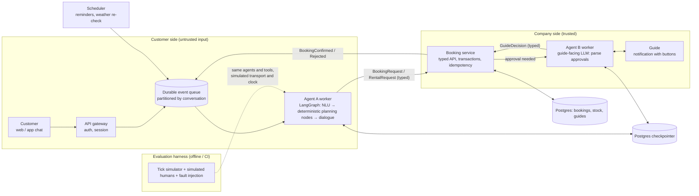

# From test-task simulation to a production trip planner

This note reviews the current solution against the test task and against what a production version of the product would need. It answers three questions:

1. Do we need the tick-based runtime?
2. Is the current agentic design (two LLM agents talking in free text) right for this use case?
3. What else in the code has to change before it could serve real customers?

**Summary.** The repository is a good answer to the test task. The tick-based environment, the two LLM agents, the simulated humans and the fault injection are all explicit requirements (slides 4 and 6), so the submission should keep them. A production system should not run on that design. The simulation should stay as the **evaluation harness**, and the same agents and tools should run on an **event-driven, durable runtime**, with deterministic steps in code, typed messages between agents and a real human-in-the-loop for the guide.

---

## 1. The two contexts

| | Test task | Production product |
|---|---|---|
| Goal | Show a multi-agent system that converges to a deterministic outcome under faults | Book safe, correct trips for many concurrent customers |
| Humans | Simulated by LLM personas, answer instantly | Real people who answer in minutes, hours or days |
| Time | Discrete ticks (required: "akin to a discrete-time simulation") | Wall clock, timers, scheduled follow-ups |
| Agents | Two LLM agents (required) | As much deterministic code as possible; LLM where judgement or language is needed |
| Faults | Injected on purpose (required) | Real transient errors, handled by the infrastructure |
| State | One run in memory, then a JSON trajectory | Long-lived conversations, durable, multi-tenant |
| Success | `convergence_rate` over 5 runs | Conversion, safety, cost per booking, latency, customer satisfaction |

Most of the recommendations below come from the gap between these two columns.

---

## 2. Ticks

### Keep them in the submission

`Simulation` ([ml/environment/core.py](../trip_planner/app/ml/environment/core.py)) is sound:

- A message sent at tick *t* is delivered at *t + 1*, so the causal order is explicit and the trajectory is easy to read.
- Everyone with mail acts concurrently inside a tick (`asyncio.gather`), which covers the parallelism requirement.
- Runs end as `converged`, `stalled` or `timeout`, so no run hangs.
- Seeded fault streams per action keep failures reproducible no matter how the agents interleave.

### Drop them in production

A tick is a **global barrier**: tick *t + 1* starts only when every participant with mail has finished tick *t*. That breaks down for a real product:

- **Humans are slow and work on their own schedule.** The guide approves a trip hours later and the customer replies the next day. Play mode already shows the problem: while Human A types, the whole simulation, including Agent B and the guide, is frozen for up to `live_input_timeout_s` (30 minutes).
- **Latency.** Each hop waits for the next tick. The chain A → B → guide → B → A takes four barrier rounds even when the LLM work is fast.
- **Scale.** A tick only means something inside one closed world. Production has thousands of independent conversations with no shared clock.

### What replaces them

An event-driven, actor-style runtime:

- Every incoming message (from a customer, a guide or another agent) is an **event** on a durable queue.
- A worker takes the event, loads that agent's state for that conversation from a durable checkpointer, runs **one turn**, saves the state and emits new events.
- Ordering is guaranteed **per conversation and per agent** (a partitioned queue or a per-key lock), not globally.
- `stalled` and `timeout` become **scheduled timers**: "guide has not answered in 2 hours → remind, then escalate to the duty manager"; "trip is in 24 hours → re-check the weather and notify the customer if it changed".

The current code is close to this. `Participant.act(inbox)` ([participant.py](../trip_planner/app/ml/environment/participant.py)) is already an event handler in all but name. If **transport and clock** become pluggable (tick bus and simulated clock for the harness, durable queue and wall clock for production), the same agents and tools run in both.

---

## 3. The agentic design

### The prompts are a workflow written in prose

Both instructions are numbered procedures. Agent B, for example: *"Choose the first trail in agent_a's order that is open, and the first date in agent_a's order that has a free guide."* That is deterministic business logic run by an LLM.

The README lists the failures this caused in live runs:

- Agent B invented a trail fact (no rockfall risk), so the guide waived the helmet.
- Agent A removed rented gear from the plan to get past the `deliver_final_plan` check.
- Agent B forwarded the guide's notices, which triggered a second, redundant booking request.

Each was fixed with more prompt rules or richer tool output. That works for one scenario, but more prompt rules are a sign the logic belongs in code.

The same goes for determinism. Today convergence relies on temperature 0 plus the OpenAI `seed`, which is best-effort only. Decisions made in code are deterministic by construction.

### Keep the A/B boundary, change what crosses it

There is a real reason to keep two agents in production: a **trust boundary**.

- Agent A reads untrusted customer text.
- Agent B holds `create_booking`, guide schedules and stock.

Today a prompt-injected customer message can shape the prose Agent A sends, and Agent B acts on that prose. With typed contracts and authorization on the server side, nothing a customer writes can make Agent B book, cancel or reserve on its own.

### Target split

| Concern | Today | Production |
|---|---|---|
| Understanding the customer (age, fitness, health, interests, party, gear) | LLM, free text | LLM with **structured output** into a validated `CustomerProfile`; clarifying questions when fields are missing |
| Fitness limits, trail ranking, weather, gear rules | LLM calls rule-based tools in a set order | **Deterministic graph nodes** (the logic in `ml/fitness_assessment`, `ml/trail_selection`, `ml/equipment_check` is already in Python) |
| Choosing the option | LLM in Agent B picks the first open trail and, separately, the first free date | Code that ranks **(trail, date) pairs** on closure, guide availability, weather and fitness together |
| A ↔ B communication | Free-text messages that the other LLM has to parse | **Typed contracts**: `BookingRequest`, `BookingConfirmed`, `BookingRejected`, `RentalRequest`, `RentalConfirmed` (A2A protocol or plain service APIs) |
| Agent B | Full LLM agent | Mostly a **back-office service**; an LLM only to turn the guide's free-text reply into `{approved, conditions[]}` |
| Guide approval | LLM persona | Real **human-in-the-loop**: a notification with approve / reject / propose another date and structured conditions, implemented with LangGraph `interrupt()` on a durable checkpointer |
| Final plan for the customer | LLM fills `TripPlan`, validated against booking and reservation | Plan assembled in code from stored state; the LLM only writes the friendly explanation |
| Exceptions: no feasible option, bad weather week, guide proposes another date, customer changes their mind | Prompt rules | **This is where the LLM earns its cost**: negotiation, explanation, trade-offs |

### Target architecture

---

## 4. Gaps in the current code

Ordered by priority. File links point at the current implementation.

### P0: correctness, safety, compliance

1. **Agent state is in memory and grows without limit.** Each agent gets one `InMemorySaver` ([inference/services/core.py](../trip_planner/app/inference/services/core.py)), shared by every run, and threads are never deleted. Every run leaks memory, and a restart loses every conversation.
   *Change:* `langgraph-checkpoint-postgres`, with thread cleanup or a TTL.
2. **Bookings and rental reservations live in a dict per run** ([local_store/booking.py](../trip_planner/app/core/repositories/local_store/booking.py), [local_store/rental_stock.py](../trip_planner/app/core/repositories/local_store/rental_stock.py)). `create_booking` checks guide availability, then writes. Two customers booking the same guide on the same day at the same moment can both succeed.
   *Change:* use the `bookings` table and its partial unique index (one confirmed booking per guide per day), in a transaction; take rental stock with `SELECT … FOR UPDATE` or an atomic conditional decrement.
3. **The idempotency key comes from LLM-supplied content** (`trail_id | date | customer_name`). A different spelling of the name creates a second booking, and nothing ties the booking to the authenticated customer.
   *Change:* customer identity from the session, never from a tool argument; idempotency key from a request or conversation id.
4. **Health data is GDPR special-category data, and the company operates in Spain.** Health conditions currently go to OpenAI, into Langfuse traces and into plain JSON trajectories on disk.
   *Change:* an EU-resident model endpoint (Azure OpenAI EU region or a self-hosted model), PII redaction before tracing, explicit consent, retention limits, a data processing agreement, encryption at rest.
5. **Safety rules are not enforced in code.** `deliver_final_plan` checks that the plan matches the booking and the reservation (good), but nothing stops a booking on a day with a storm warning or beyond the customer's fitness limits if the LLM passes the wrong arguments.
   *Change:* hard checks in the booking service (weather thresholds, fitness limits, party size, closures), plus a medical disclaimer in the plan.

### P1: reliability and scale

6. **Simulation concerns leak into production tools.** Every tool reads `RunContextProvider`, which carries the message bus, the trajectory recorder and the fault injector, and `_call_with_faults` calls `fault_injector.maybe_fail` inline ([agents/tools/base.py](../trip_planner/app/agents/tools/base.py)).
   *Change:* domain services that know nothing about the simulation; fault injection as an adapter wrapper installed only by the harness; trajectory recording as a callback.
7. **Retries are stacked three deep.** Up to 3 attempts inside the tool, then the prompt tells the LLM to call the tool up to 2 more times (each with its own 3 attempts), on top of the `ChatOpenAI` client's own retries. One flaky dependency can cost about 9 attempts and several extra LLM turns.
   *Change:* retry real transient errors (HTTP, DB) once, in the infrastructure layer (tenacity with timeouts and a circuit breaker). After that, the LLM gets a terminal error and an escalation path, not a "retry" instruction.
8. **Live runs are pinned to one process.** AG-UI runs are kept in `AgUiService._runs` per process, capped at `max_live_runs` (20). `POST /simulations` is synchronous and takes 30–60 seconds.
   *Change:* stateless API workers, durable state, a job queue, resumable SSE streams; `202 Accepted` + status polling or webhooks for batches.
9. **Conversations have no natural end.** A run ends when the customer marks the conversation complete. A real booking has a life after that: re-check the weather the day before, notify about closures, handle cancellations and changes.
   *Change:* a conversation and booking lifecycle with states and scheduled jobs.
10. **LLM provider resilience.** The model is configured with the `gpt-4.1-mini` alias.
    *Change:* pin a dated snapshot, add a fallback model, handle rate limits and quotas, set a per-conversation token budget.

### P2: cost, observability, evaluation

11. **The context grows without limit.** The checkpointer appends every message, and every model call resends the whole history. The current run uses about 27 LLM calls and 57k tokens per plan.
    *Change:* trim or summarize history, use prompt caching for the static system prompt, and use a smaller model for extraction. Moving the deterministic steps out of the LLM cuts most of this anyway.
12. **Observability is tracing only.** Langfuse traces are a good base, and the local trajectory metrics are useful.
    *Change:* add OpenTelemetry metrics (Prometheus or similar) with SLOs: turn latency p50/p95, error rate per tool, cost per booking, booking conversion, guide response time. Add correlation ids in structured logs and alerting. Store trajectories in the existing `simulation_runs` and `trajectory_events` tables instead of files.
13. **Evaluation covers one scenario.** The tick simulator is the most valuable part of the repo for production, because it can replay any scenario with simulated humans and injected faults.
    *Change:* turn it into a CI regression suite over a scenario grid (the README plans 50–100), compare against a stored baseline on every prompt, model or data change, and add an LLM judge calibrated on human-labelled trajectories. Use Langfuse datasets for experiments.

---

## 5. What stays as it is

Several parts carry over to production unchanged or nearly so:

- **The tick simulator, simulated humans and fault injector**, as the evaluation harness.
- **The rule-based components** in `ml/` (fitness assessment, trail selection, equipment check, weather forecast with fixture and Open-Meteo variants).
- **Plan validation against stored state** in `deliver_final_plan`, which becomes a check in the booking service.
- **Topology enforcement** on the bus, which becomes authorization: who may send what to whom.
- **The Postgres schema, migrations and indexing pipeline.**
- **Langfuse tracing** grouped by session and participant.
- **Per-run isolation** through `RunContext`, which becomes per-conversation isolation.

---

## 6. Suggested order of work

1. Split domain services from simulation concerns (P1.6). Everything else builds on this.
2. Move bookings, stock and agent state to Postgres (P0.1, P0.2, P0.3).
3. Replace the free-text A ↔ B messages with typed contracts, and move option selection into code.
4. Turn Agent B into a booking service plus a small guide-facing LLM, and make the guide approval a real `interrupt()`.
5. Add the event-driven runtime and scheduler behind the same `Participant` interface; keep the tick transport for the harness.
6. Compliance and safety work (P0.4, P0.5) in parallel with steps 2–5.
7. Grow the scenario grid and put the harness in CI.

---

## 7. Short answer for the interview

> The task asked for a discrete-time multi-agent simulation, so the runtime is tick-based and both sides are LLM agents. In production I'd keep the same agents, tools and contracts but run them on an event-driven, durable runtime. Deterministic business steps become graph nodes, the agents exchange typed messages across a trust boundary, the guide becomes a real human-in-the-loop interrupt, and the tick simulator stays as the offline evaluation and regression harness that runs the same code against simulated humans and injected faults.
